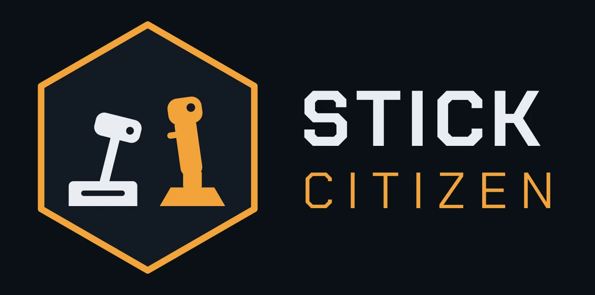
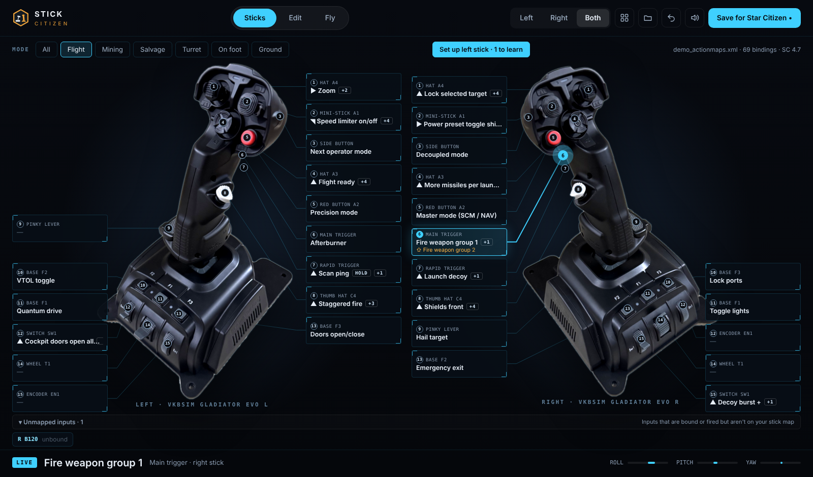

<p align="center"></p>

# Stick Citizen

See your HOSAS on screen with every control labeled by its Star Citizen action, drag actions onto it, fly-test it, and save a layout SC can import. Built for dual VKB Gladiator NXT EVO sticks; no Joystick Gremlin needed.

<p align="center"></p>

## ⬇ Download

**[Get the latest release](https://github.com/ShoelessTim/stick-citizen/releases/latest)** (Windows 10/11):

- `StickCitizen-vX.Y.Z-Setup.exe`: installs for your user only, with Start Menu and desktop icons. Recommended.
- `StickCitizen-vX.Y.Z.exe`: one file, no install, just double-click.

The exe isn't code-signed, so Windows SmartScreen may warn the first time. Click **More info**, then **Run anyway**.

## Quick start

1. **Plug in your sticks and open Stick Citizen.** Both show up on their own photos, every control already named and placed.
2. **Set up (about a minute).** On VKB's stock firmware profile the button numbers are built in, so Set up only asks for the mini-stick. Changed your VKB config? Set up walks you through each control: the photo zooms in, you press it, done. **Skip** anything your grip doesn't have.
3. **Pick a starting layout** (the four-squares button): **Sublight**, a combat-ready dual-stick layout, or any exported SC layout file. Or start blank.
4. **Press anything** and its label lights up with the action it does in SC, shown big and spoken.
5. **Edit** to drag actions onto controls. Each control has a **base** row and a **⇧ shift** row.
6. **Fly** opens a ring course with your bindings so you can feel them without launching the game.
7. **Save for Star Citizen** writes a layout file into SC's `controls\mappings` folder. In SC: Options → Keybindings → Control Profiles → pick it.

Stick Citizen never edits SC's live `actionmaps.xml` (SC overwrites it anyway). The **Mode** chips (Flight, Mining, Salvage, Turret, On foot, Ground) filter to one kind of play. Your setup lives in `%APPDATA%\StickCitizen`, so updating never loses it.

## Shift layers and the mini-stick

Star Citizen can't do joystick shift layers or stick-to-mouse on its own; those live in your stick's firmware (VKB: VKBDevCfg). A shifted button reports as a higher button number: map it as the shift layer of its control and bind it there.

The A1 mini-stick has three firmware modes, switched by pressing it: mouse, 8-way hat, and analog. Mouse mode sends mouse movement, not joystick input, so Stick Citizen can't see it; switch to hat or analog mode to bind it.

## Where it's going

**Next up**
- A "how do I unbreak my layout" fix-it tool: press anything and see what the stick sent, what SC does with it, and a plain-English diagnosis.
- A mini-stick mode indicator (mouse / hat / analog).
- More starting layouts, with their creators' permission.

**Planned**
- Setup sheet export: a checklist of what to change in VKBDevCfg and in Star Citizen.
- Both mini-sticks as analog sticks for gamepad-style on-foot play; stick LEDs that follow modes; an LED test mode.
- Device profiles beyond VKB. Contributions welcome (see below).

## Supported hardware

- VKB Gladiator NXT EVO, left and right, Premium grip: built in.
- Other sticks show up without a built-in profile: in **Edit** you can set your own photo and name controls as you press them. A built-in profile is a JSON file plus a photo in `stick_citizen/data/starters/`; pull requests for more sticks are welcome.

## Build from source

Python 3.12 on Windows:

```
pip install -r requirements.txt pyinstaller
python run_stick_citizen.py
```

Tests: `set SDL_VIDEODRIVER=dummy` then `python -m pytest -q`. The release build is in `.github/workflows/build.yml`.

## Contributing

Bug reports and pull requests are welcome. Please include your stick model and grip, and for binding problems the layout file you used. Security issues: see [SECURITY.md](SECURITY.md).

## License, disclaimer and credits

Code: MIT (see [LICENSE](LICENSE)). The stick photos are the author's own and are included under the same license.

Stick Citizen is an unofficial, fan-made Star Citizen tool, not affiliated with or endorsed by the Cloud Imperium group of companies. Star Citizen® is a registered trademark of Cloud Imperium Rights LLC. VKB and Gladiator are trademarks of VKB-Sim; this project isn't affiliated with VKB.

The Sublight layout is inspired by Subliminal's Enhanced dual VKB Gladiator NXT layout ([subliminal.gg](https://subliminal.gg)). It was rebuilt from scratch and is not their file.
